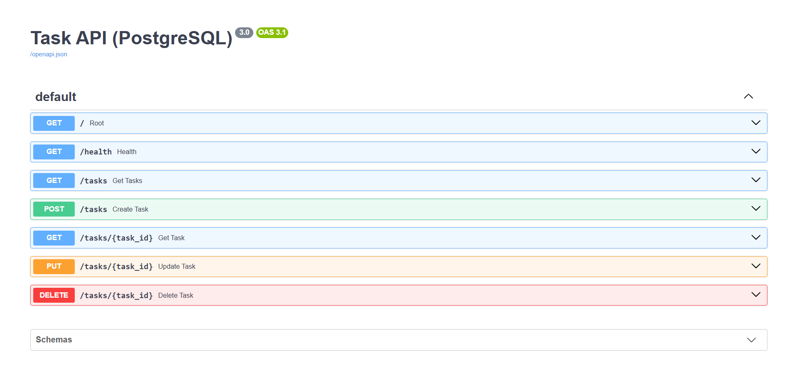
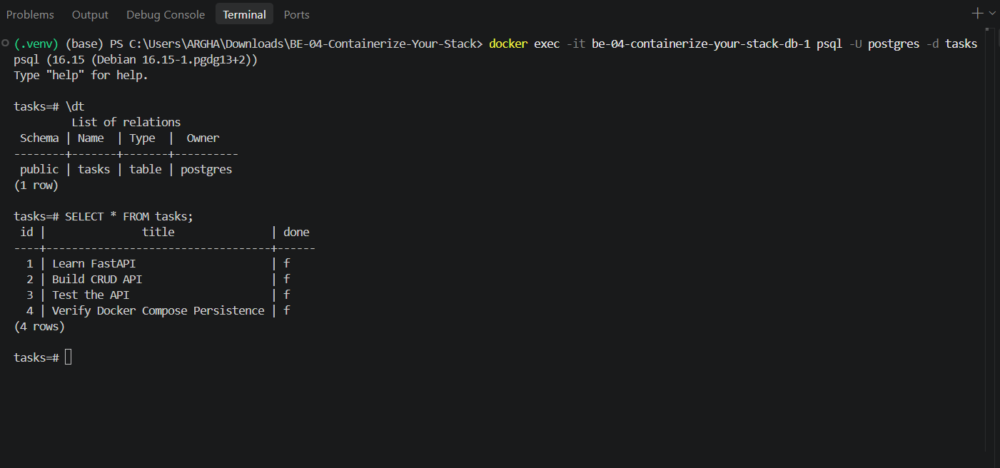

# Task API (PostgreSQL & Docker Compose) - BE-04

Part 3 of the FlyRank Backend AI Engineering track. A containerized CRUD API built with Python and FastAPI, featuring PostgreSQL database storage, Docker containerization, and one-command Docker Compose orchestration.

## Features

- Create tasks
- Read all tasks or a single task
- Update a task title and/or completion status
- Delete tasks
- Input validation and 404 error handling
- Interactive Swagger UI documentation
- One-command orchestration via Docker Compose (`docker compose up --build`)
- Persistent PostgreSQL storage with automated health checks (`pg_isready`) and named volumes (`taskdata`)

## Requirements

- Python 3.10+
- FastAPI
- Uvicorn
- PostgreSQL 16
- Docker & Docker Compose

## Quickstart (Under 5 Minutes Round-Trip)

Clone the repository, configure environment variables, and launch the entire stack with a single command:

```bash
git clone [https://github.com/Arghachakraborty05/BE-04-Containerize-Your-Stack.git](https://github.com/Arghachakraborty05/BE-04-Containerize-Your-Stack.git)
cd BE-04-Containerize-Your-Stack
cp .env.example .env
docker compose up --build
```

The API will run at:

`http://localhost:8000`

Swagger UI documentation is available at:

`http://localhost:8000/docs`

## Environment Variables

Configuration is managed via environment variables. A template is provided in `.env.example`:

- **DATABASE_URL:** Connection string for PostgreSQL (defaults to `postgresql://postgres:dev@db:5432/tasks` within the Docker network).

Ensure `.env` is git-ignored while `.env.example` is committed.

## Evolution of the Database Setup & Containerization

- **Standalone Database Testing (Stage 0)**

Initially, the course guideline suggested running an individual container command to spin up the database manually:

```powershell
docker run --name taskdb -e POSTGRES_PASSWORD=dev -e POSTGRES_DB=tasks -p 5432:5432 -v taskdata:/var/lib/postgresql/data -d postgres
```

- **Note on PostgreSQL Version Pinning (`postgres:16`)**

While the guideline uses the rolling `postgres` tag (which defaults to the latest version like PostgreSQL 18+), newer versions introduce strict data directory validation bugs and initialization errors when mounting named volumes (`taskdata`) on Windows environments. 

Pinning explicitly to **PostgreSQL 16** (`postgres:16`) bypasses these validation bugs, ensuring stable data persistence and successful local connectivity. 

- **Standalone Production Run Command:**

```powershell
docker run --name taskdb -e POSTGRES_PASSWORD=dev -e POSTGRES_DB=tasks -p 5432:5432 -v taskdata:/var/lib/postgresql/data -d postgres:16
```

- **Full-Stack Orchestration (Final State)**

In the final stage, this standalone workflow was automated into `compose.yaml` and a lightweight `Dockerfile`, combining the database and FastAPI service into a single synchronized lifecycle managed by Docker Compose.

- **Guideline Specified Configuration**

When transitioning from standalone containers to Docker Compose, a basic guideline configuration maps the API and database together with a simple `depends_on: [db]:`

```yaml
# Guideline Specified Configuration
services:
  api:
    build: .
    ports: ["3000:3000"]
    environment:
      DATABASE_URL: postgres://postgres:dev@db:5432/tasks
    depends_on: [db]
  db:
    image: postgres
    environment:
      POSTGRES_PASSWORD: dev
      POSTGRES_DB: tasks
    volumes: [taskdata:/var/lib/postgresql/data]
volumes:
  taskdata:
```

- **The Problem Encountered (Startup Race Condition)**

The FastAPI container booted a split-second before PostgreSQL finished initializing its internal data directories and opening port `5432`, resulting in a connection refusal error and application crash:

```plaintext
api-1  |psycopg.OperationalError: connection failed: connection to server at "172.18.0.2", port 5432 failed: Connection refused
api-1  |     Is the server running on that host and accepting TCP/IP connections?
api-1  |ERROR: Application startup failed. Exiting.
```

- **The Production Solution (`pg_isready` Health Check)**

To solve this, a database health check using `pg_isready` was integrated, and the API service was configured with `condition: service_healthy`. This forces Docker to wait until PostgreSQL is actively accepting connections before spinning up FastAPI.

Final Production `compose.yaml`: 

```yaml
services:
  api:
    build: .
    ports:
      - "8000:8000"
    environment:
      DATABASE_URL: postgresql://postgres:dev@db:5432/tasks
    depends_on:
      db:
        condition: service_healthy

  db:
    image: postgres:16
    environment:
      POSTGRES_USER: postgres
      POSTGRES_PASSWORD: dev
      POSTGRES_DB: tasks
    ports:
      - "5432:5432"
    volumes:
      - taskdata:/var/lib/postgresql/data
    healthcheck:
      test: ["CMD-SHELL", "pg_isready -U postgres -d tasks"]
      interval: 5s
      timeout: 5s
      retries: 5

volumes:
  taskdata:
```

- **Containerizing FastAPI (Dockerfile)**

The backend service is packaged using a lightweight Python slim base image:

```Dockerfile
FROM python:3.11-slim

WORKDIR /app

COPY requirements.txt .
RUN pip install --no-cache-dir -r requirements.txt

COPY . .

EXPOSE 8000

CMD ["uvicorn", "main:app", "--host", "0.0.0.0", "--port", "8000"]
```

## API Endpoints

| Method |        Endpoint       |               Description                   |
|--------|-----------------------|---------------------------------------------|
| GET    |          `/`          | Get API information and available endpoints |
| GET    |       `/health`       |       Check whether the API is running      |
| GET    |       `/tasks`        |               Get all tasks                 |
| POST   |       `/tasks`        |             Create a new task               |
| GET    |   `/tasks/{task_id}`  |          Get a single task by ID            |
| PUT    |   `/tasks/{task_id}`  |            Update a task by ID              |
| DELETE |   `/tasks/{task_id}`  |            Delete a task by ID              |

## Example Request & Response

### Create a task

```bash
curl -i -X POST http://localhost:8000/tasks \
  -H "Content-Type: application/json" \
  -d '{"title": "Verify Docker Compose Persistence"}'
```
### Response:

```http
HTTP/1.1 201 Created
date: Sat, 24 Oct 2026 10:58:52 GMT
server: uvicorn
content-length: 65
content-type: application/json

{"id":4,"title":"Verify Docker Compose Persistence","done":false}
```

## Interactive Documentation

The API utilizes FastAPI's built-in Swagger UI for interactive API documentation and live endpoint testing.

Open:

`http://localhost:8000/docs`



## Database Architecture & Verification

### Database Architecture

- **Named Volume (`taskdata`):** Mapped to `/var/lib/postgresql/data` inside the container, ensuring all records survive container restarts and full stack teardowns (`docker compose down`).

- **Automated Health Checks:** Uses `pg_isready` with `condition: service_healthy` to prevent API startup race conditions.

### Database Verification

Inspection of the running PostgreSQL database is performed directly using `psql`:

```bash
docker exec -it be-04-containerize-your-stack-db-1 psql -U postgres -d tasks
```

**SQL Query:**

```sql
\dt
SELECT * FROM tasks;
```

**Database Inspection:**



## Project Structure

```text
BE-04-Containerize-Your-Stack/
├── main.py
├── Dockerfile
├── compose.yaml
├── requirements.txt
├── .env.example
├── .gitignore
├── README.md
└── screenshots/
    ├──db_screenshot.png
    └── swagger-ui.png
```